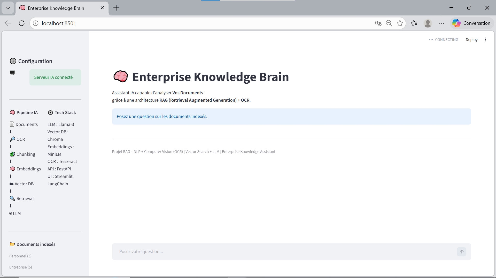
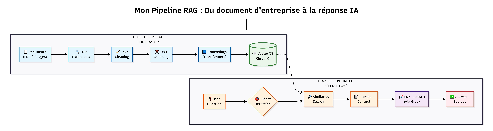
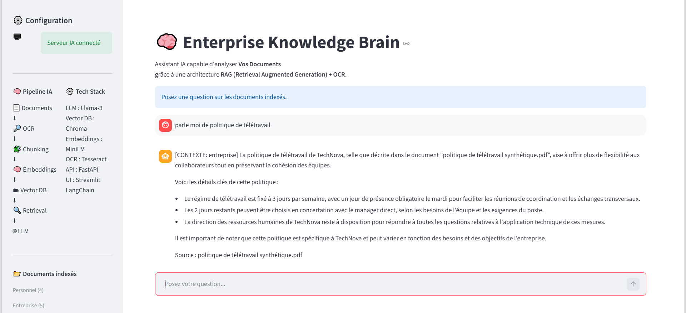
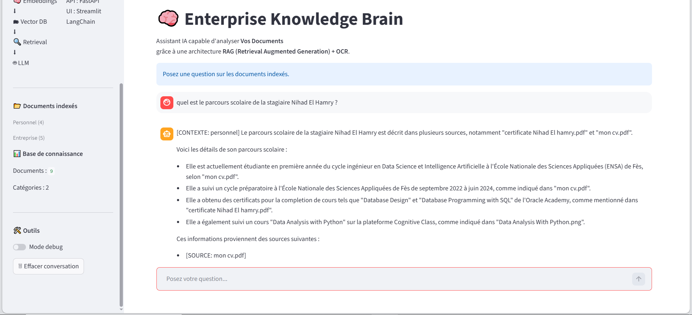

# Enterprise Knowledge Brain

### Assistant IA avec RAG & OCR Multi-source

Un assistant intelligent capable de répondre à des questions complexes sur des documents personnels et d'entreprise (PDF, images, scans) grâce à une architecture **RAG (Retrieval-Augmented Generation)**.

## Démo

L'application offre une interface épurée et intuitive développée avec Streamlit. La barre latérale permet de visualiser en temps réel l'état de connexion du serveur backend FastAPI, de consulter la stack technique utilisée, ainsi que les statistiques de la base de connaissances (nombre de documents indexés par catégorie : Personnel ou Entreprise). Un mode "Debug" et un outil de réinitialisation de la conversation sont également intégrés pour faciliter les tests.

## Fonctionnalités

- **Recherche sémantique avancée** (RAG) pour des réponses précises et contextualisées.
- **Support des documents scannés** : Pipeline OCR intégré (Tesseract & pdf2image) pour traiter les images et PDF non textuels.
- **Détection d’intention** : Utilisation du LLM pour classifier la question et filtrer intelligemment la recherche.
- **Séparation des données** : Isolation stricte entre les contextes 'personnel' (CV, diplômes) et 'entreprise' (règlements, rapports).
- **Citations de sources** : Chaque réponse inclut le nom des fichiers consultés pour garantir la fiabilité.
- **Interface Interactive** : UI fluide développée avec Streamlit et Backend haute performance avec FastAPI.

## Architecture Technique

Ce diagramme détaille le flux de données complet du système.

Le système repose sur un pipeline de données modulaire :

1.  **Ingestion** : Chargement des fichiers, nettoyage textuel (`re`) et découpage intelligent en segments (`RecursiveCharacterTextSplitter`).
2.  **Embedding** : Transformation des segments de texte en vecteurs numériques via `sentence-transformers`.
3.  **Stockage** : Indexation et persistance dans la base de données vectorielle **ChromaDB**.
4.  **Routage Sémantique** : Classification de la question par le LLM pour appliquer un filtre de catégorie (`metadata filter`).
5.  **Génération (Augmented)** : Construction d'un prompt enrichi avec le contexte récupéré et génération de la réponse finale via **Llama-3**.

## Stack Technique

* **LLM** : Llama-3-70B (via Groq API)
* **Orchestration** : LangChain
* **Vector DB** : ChromaDB
* **Backend** : FastAPI & Uvicorn
* **Frontend** : Streamlit
* **OCR** : Tesseract & pdf2image
* **Embeddings** : HuggingFace (`paraphrase-multilingual-MiniLM-L12-v2`)

## Installation

### 1. Prérequis

- Python 3.10+
- [Tesseract OCR](https://github.com/UB-Mannheim/tesseract/wiki) installé sur votre machine.
- [Poppler](https://github.com/oschwartz10612/poppler-windows/releases) (nécessaire pour la conversion PDF vers Image).

### 2. Setup du projet

- Cloner le projet
git clone https://github.com/nihadElh/Enterprise-RAG-OCR-Assistant.git
cd Enterprise-RAG-Assistant

- Installer les dépendances
pip install -r requirements.txt

### 3. Configuration des variables d'environnement

Créez un fichier .env à la racine du projet :

GROQ_API_KEY=votre_cle_api_groq
TESSERACT_PATH=C:\Program Files\Tesseract-OCR\tesseract.exe
POPPLER_PATH=C:\Program Files\poppler-xx\Library\bin

### 4. Utilisation

Phase d'Ingestion (Placez vos documents dans ./data_documents au préalable) :

python ingest.py
Lancement du Serveur (Backend) :

python main.py
Lancement de l'Application (UI) :

streamlit run app_ui.py

## Exemple d'interaction

Cas 1 : Requête sur un document d'entreprise (PDF textuel)
Dans cet exemple, l'utilisateur pose une question sur la politique de télétravail. L'assistant détecte correctement l'intention [CONTEXTE: entreprise], interroge la base de connaissances et synthétise les informations clés (jours par semaine, conditions) en citant explicitement le document source (politique de télétravail synthétique.pdf).

Cas 2 : Requête sur des documents personnels (Scans et Images)
Ici, l'utilisateur s'informe sur le parcours scolaire d'une personne spécifique. L'assistant identifie l'intention [CONTEXTE: personnel]. Ce cas démontre la puissance du pipeline OCR : l'IA est capable de croiser des informations provenant d'un CV PDF (mon cv.pdf) et d'un certificat au format image (Data Analysis with Python.png) pour fournir une réponse complète et précise.

## Choix Techniques

- Utilisation de ChromaDB pour sa simplicité et rapidité en local
- Utilisation de LangChain pour orchestrer le pipeline RAG
- Séparation des données pour éviter les hallucinations croisées

## Cas d'utilisation

- Assistant RH pour analyse de CV
- Recherche documentaire interne
- Assistant personnel intelligent
- Automatisation du support documentaire

## Améliorations futures
- Persistance de l'historique des conversations en base de données SQL.

- Support des formats Excel (.xlsx) et PowerPoint (.pptx).

- Conteneurisation du projet avec Docker et Docker-compose.

- Déploiement Cloud (Azure ou AWS).

## Auteur
Nihad El Hamry
Étudiante en Ingénierie Data Science & Intelligence Artificielle

## License
Ce projet est distribué sous la licence MIT.