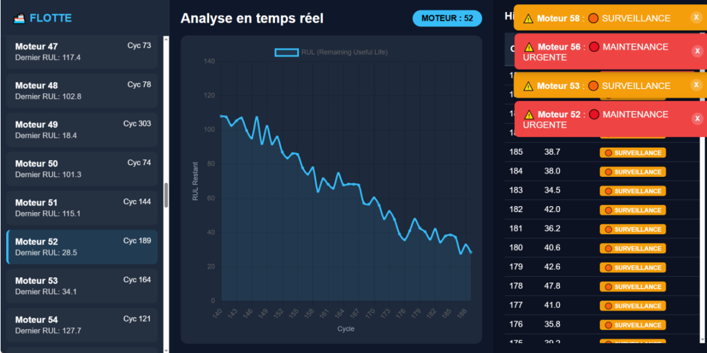
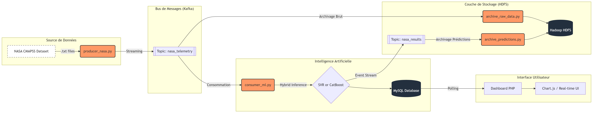
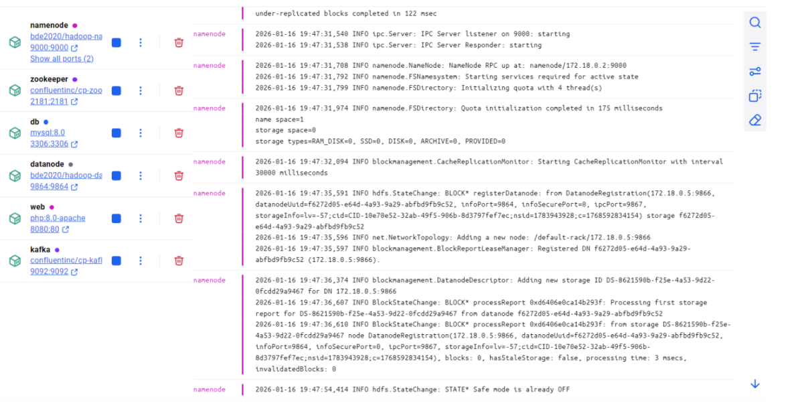

#  Aeronautics Predictive Maintenance: Real-Time Big Data Pipeline
### Système Hybride de Prédiction du RUL (Remaining Useful Life) - Dataset NASA CMAPSS

Ce projet implémente une architecture **End-to-End** pour la surveillance et la maintenance prédictive d'une flotte de moteurs d'avion. Il combine le streaming temps réel, le stockage distribué (Big Data) et une stratégie de Machine Learning hybride pour prédire avec précision la durée de vie restante des moteurs.

##  Démo & Visualisation

Aperçu de l'interface de surveillance en temps réel. Le dashboard permet de suivre l'évolution du RUL pour chaque moteur de la flotte et génère des alertes de maintenance automatiques.

##  Architecture du Système

Le projet repose sur une **Architecture Lambda** permettant de traiter les données à la fois en temps réel et en mode batch :

1.  **Ingestion (Producer)** : Simulation d'une flotte de moteurs envoyant des données capteurs (Température, Pression, Vibration) via **Apache Kafka**.
2.  **Traitement (Speed Layer)** : Un consommateur Python récupère les données, applique un fenêtrage temporel et prédit le RUL en temps réel.
3.  **Stockage (Cold Storage)** : Archivage systématique des données brutes et des prédictions dans **Hadoop HDFS** pour l'audit et le ré-entraînement.
4.  **Persistance (Serving Layer)** : Stockage des derniers résultats dans **MySQL** pour une consultation rapide.
5.  **Visualisation** : Dashboard interactif développé en **PHP / Chart.js** pour le monitoring de la flotte.

##  Stratégie de Machine Learning Hybride

Pour maximiser la précision tout au long du cycle de vie du moteur, le système alterne entre deux modèles :

* **Mode "Cold Start" (SVR)** : Pour les moteurs ayant peu d'historique (<30 cycles), un modèle **Support Vector Regressor** effectue une prédiction point par point.
* **Mode "Croisière" (CatBoost)** : Dès que 30 cycles sont disponibles, un modèle **CatBoost Regressor** analyse les dépendances temporelles via une fenêtre glissante (*Sliding Window*).
* **RUL Clipping** : Application d'un plafonnement à 130 cycles qui permet de réduire le bruit sur les moteurs en début de vie où l'usure n'est pas encore apparente, améliorant ainsi la convergence des modèles.

##  Stack Technique

* **Streaming** : Apache Kafka
* **Big Data Storage** : Hadoop HDFS
* **Database** : MySQL
* **Machine Learning** : Python (Scikit-Learn, CatBoost, Joblib)
* **Orchestration & DevOps** : Docker, Docker-Compose, PowerShell
* **Frontend** : PHP, JavaScript (Chart.js), CSS TailWind

## Installation & Lancement

1. Prérequis
- Docker & Docker Desktop

- Python 3.10+

- PowerShell (pour l'automatisation)

2. Déploiement Automatique
Lancez simplement le script d'orchestration pour démarrer toute l'infrastructure (Containers, Topics Kafka, Dossiers HDFS) :

./start_all.ps1

3. Exécution du Pipeline
- Lancer l'IA (Consommateur) :

python consumer_ml.py
- Lancer l'Archivage (Optionnel) :

python archive_raw_data.py
- Lancer la Simulation (Producteur) :

python producer_nasa.py
- Accédez ensuite au Dashboard via http://localhost:8081.

## Résultats & Performance

Le système est évalué en comparant les prédictions stockées en base de données avec la "Vérité Terrain" fournie par la NASA.

- Métrique principale : MAE (Mean Absolute Error).

- Score actuel : 10.25 cycles d'erreur moyenne sur le dataset FD001.

- Pour générer votre propre rapport de performance après une simulation :

python generate_final_report.py

## Auteur

Nihad El Hamry
Élève Ingénieure en Data Science et Intelligence Artificielle
École Nationale des Sciences Appliquées (ENSA), Fès

## License

Ce projet est sous licence MIT.